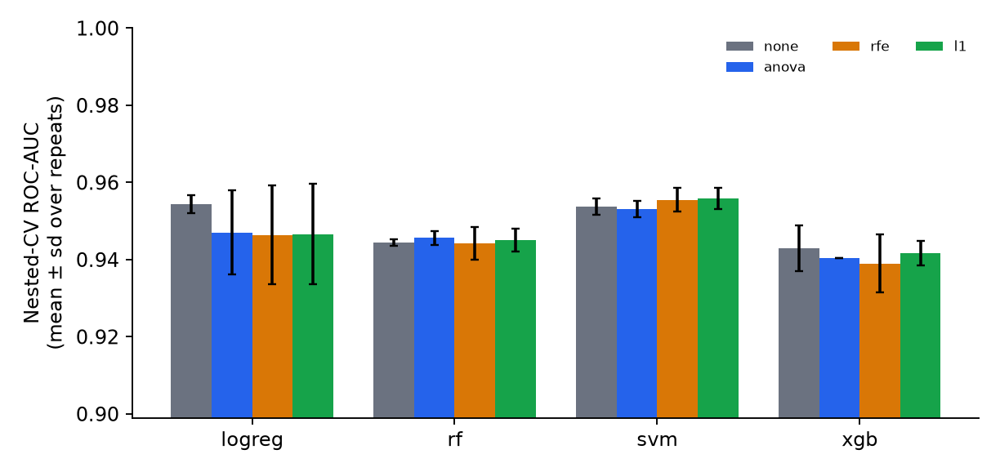
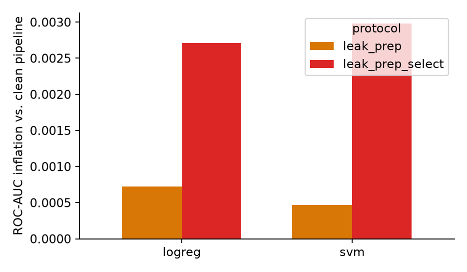

# heart-disease-nested-cv

A leakage-free benchmarking toolkit for tabular classification. It compares **Logistic Regression, Random Forest, SVM and XGBoost**,
each with no feature selection and with **filter, wrapper and embedded** selection, using **nested cross-validation** in which every
data-dependent step is refitted inside each training fold.

## Features

- **Nested cross-validation.** Outer repeated stratified K-fold for the performance estimate; inner K-fold random search for hyper-parameters
  and for the number of features kept. All configurations share identical outer splits, so results can be compared pairwise.
- **One pipeline, no leakage.** Imputation, encoding, scaling, feature selection and the classifier are stages of a single scikit-learn
  `Pipeline`, so nothing is fitted on test data.
- **Five feature selectors.** ANOVA F-test and mutual information (filter), RFE around logistic regression (wrapper), L1-logistic and
  random-forest importance (embedded).
- **Leakage experiment.** Runs the same models with leaky preprocessing and leaky selection and reports how much the score is inflated,
  plus a permuted-label test with noise features.
- **Stability of selection.** Jaccard, Kuncheva and Nogueira indices over resampled data.
- **Leave-one-site-out validation** across the four UCI hospitals.
- **Clinical operating point.** Threshold at a target sensitivity, with Platt and isotonic calibration.
- **Statistics.** Corrected resampled t-test, Holm correction, bootstrap confidence intervals, Friedman-Nemenyi.
- **Reproducible.** Fixed seeds, checksums of the raw files, one YAML config, resumable runs, unit tests.

## Quick start

```bash
git clone https://github.com/avimishra25/heart-disease-nested-cv.git
cd heart-disease-nested-cv
pip install -r requirements.txt      # Python >= 3.10, scikit-learn >= 1.8
python tests/test_core.py            # 7 tests

python run.py download               # fetch the four UCI files into data/raw/ (writes checksums)
python run.py all --profile pilot --run-id my_run
```

No internet or no data yet? Generate synthetic stand-in files in the same format and try the whole pipeline:

```bash
python run.py synth
python run.py all --profile smoke --run-id demo --synthetic
```

Results (tables, figures, `summary.md`) are written to `results/<run-id>/`.

| profile | outer CV | inner CV | tuning trials | purpose |
|---|---|---|---|---|
| smoke | 2 x 3 | 3 | 4 | check that the code runs (minutes) |
| pilot | 3 x 5 | 5 | 20 | quick, realistic run (a few hours) |
| full | 10 x 5 | 5 | 50 | complete protocol (long; resumable) |

Commands: `synth, download, audit, benchmark, leakage, stability, loso, external, report, all`.

## Example output

The numbers and charts below come from the `smoke` profile run on **synthetic stand-in data**. They only show what the output looks like and
say nothing about heart disease.

| model | selector | ROC-AUC | recall | specificity | Brier |
|---|---|---|---|---|---|
| logreg | none | 0.954 | 0.900 | 0.874 | 0.082 |
| logreg | anova | 0.947 | 0.905 | 0.832 | 0.101 |
| rf | none | 0.944 | 0.906 | 0.831 | 0.121 |
| rf | anova | 0.946 | 0.909 | 0.840 | 0.115 |
| svm | none | 0.954 | 0.903 | 0.880 | 0.083 |
| svm | anova | 0.953 | 0.890 | 0.876 | 0.084 |
| xgb | none | 0.943 | 0.886 | 0.847 | 0.095 |
| xgb | anova | 0.940 | 0.884 | 0.844 | 0.100 |





## Project layout

```
configs/default.yaml      every setting; profiles smoke | pilot | full
run.py                    command-line entry point
src/hdbench/
  data.py                 loading and cleaning (duplicates, impossible zeros, missingness rule)
  features.py             preprocessing and the FeatureSelector
  models.py               classifiers, search spaces, pipeline builder
  nested_cv.py            nested cross-validation engine
  leakage.py              clean vs leaky protocols and the permuted-label test
  stability.py            selection-stability indices
  loso.py                 leave-one-site-out and external validation
  metrics.py, stats.py    metrics, calibration, statistical tests
  audit.py, report.py     data audit and result tables/figures
  synthetic.py            synthetic data generator for testing
tests/test_core.py        unit tests
```

## Data

The UCI Heart Disease files (Cleveland, Hungary, Switzerland, VA Long Beach) are public and are downloaded by `python run.py download`;
they are not stored in this repository. Source: <https://archive.ics.uci.edu/dataset/45/heart+disease>.

## License

MIT, see [LICENSE](LICENSE).
